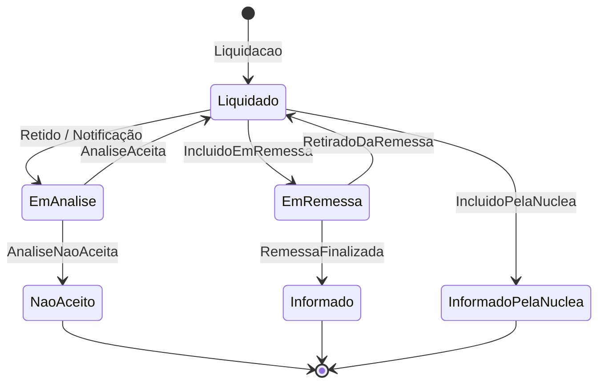
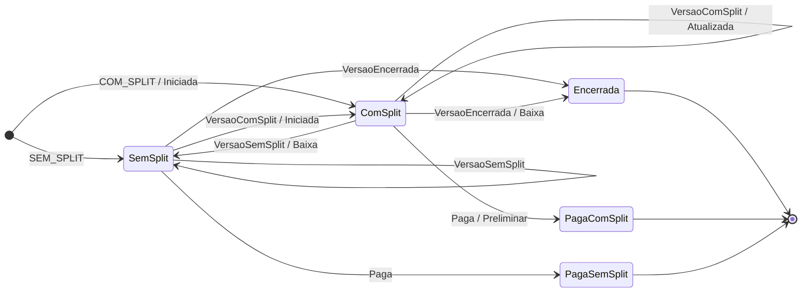
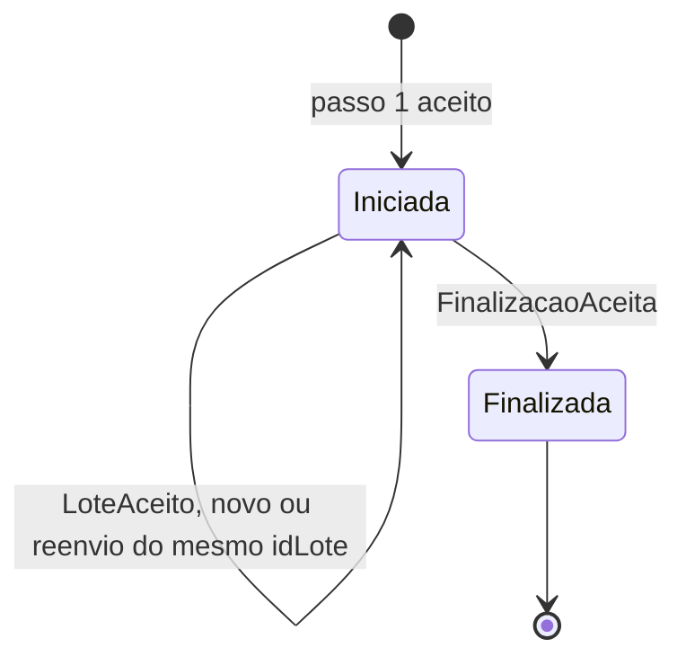
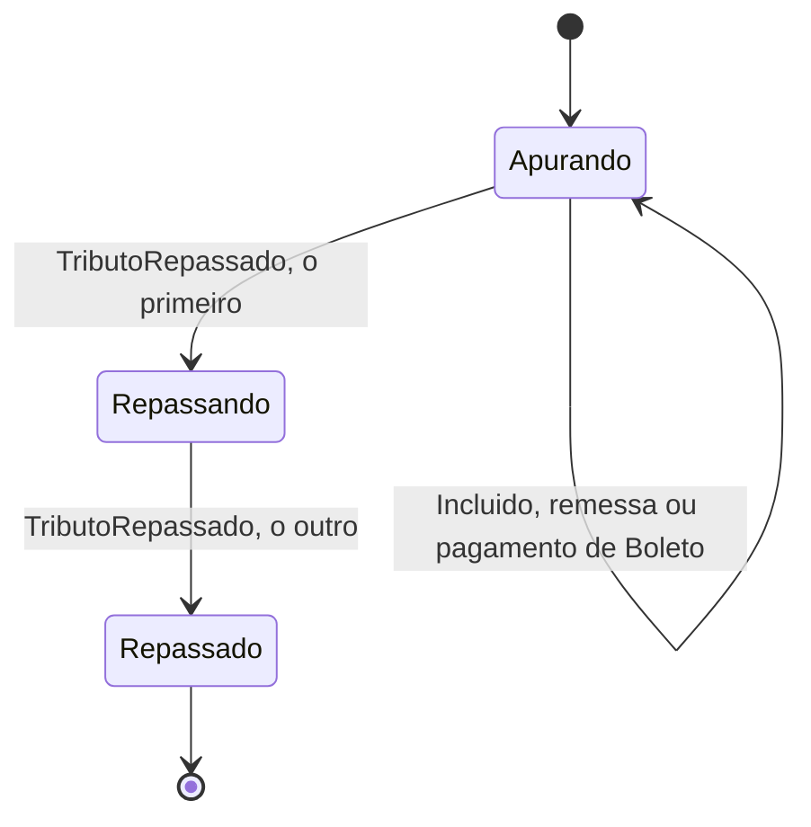
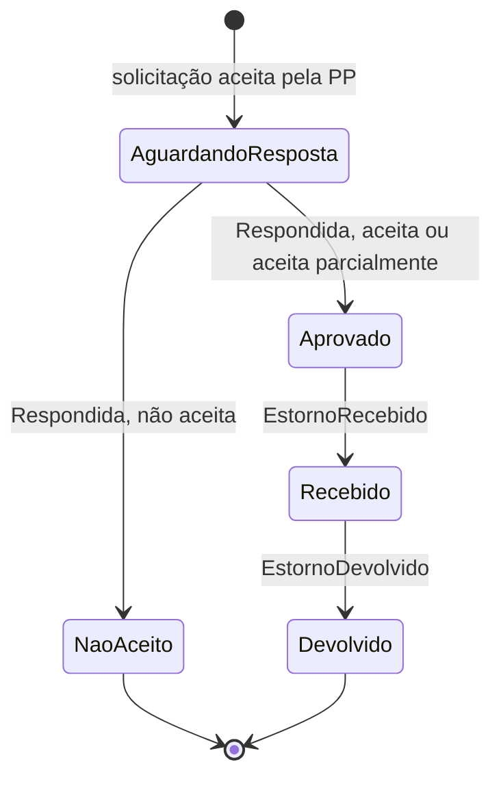
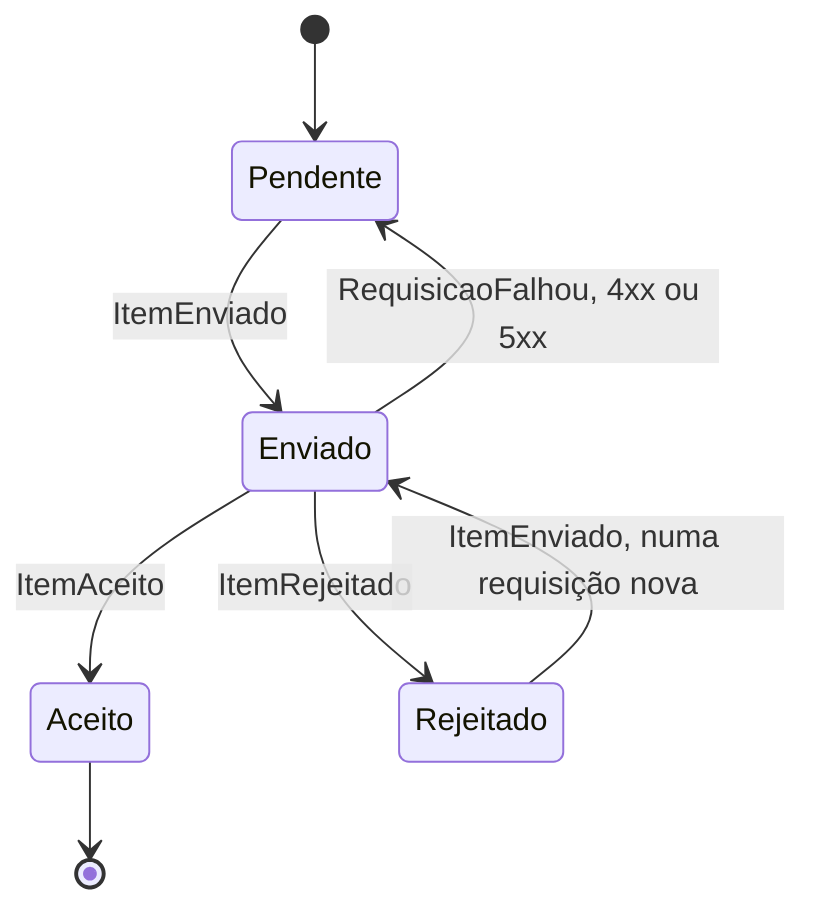
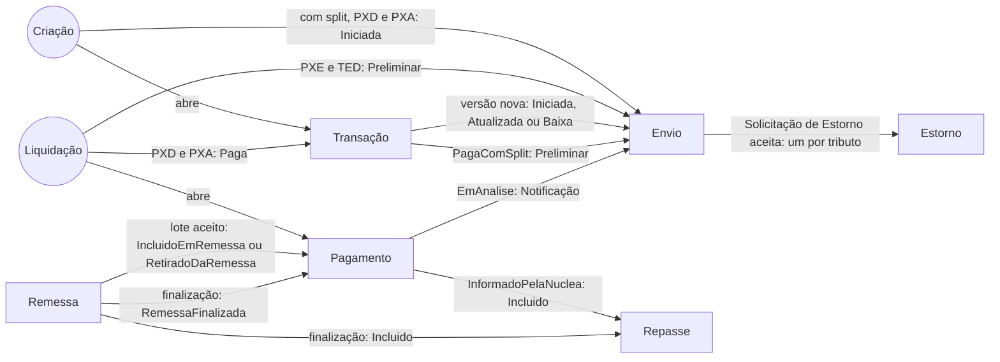

# Máquinas de estado

As seis máquinas do split-service (`split-service/src/main/java/split/servico`) e a ponte entre elas.
Toda seta tem uma guarda; evento que não cabe é `Invalida` e o estado não muda. `[*]` à direita marca estado final.
Nas transições, `evento / informe` diz o informe que o passo pede à PP.

## Pagamento

Uma para os seis arranjos. O arranjo só decide quem informa a segregação: o próprio PSP ou a Núclea (`Arranjo.viaNuclea`).

- A análise não conclui antes da liquidação. A aceita passa a ser a Liquidação Financeira (Operações §6.1 e §9.1).
- `IncluidoEmRemessa` só nos arranjos em que o PSP informa (PXD, PXA, PXE, TED, TEF), com remessa do mesmo arranjo.
  `RetiradoDaRemessa` e `RemessaFinalizada`, só da mesma remessa. `IncluidoPelaNuclea` só no Boleto.
- O estorno não é estado do pagamento: `Informado` continua devendo o repasse (Operações §10.1).

## Transação (PXD e PXA)

No Boleto quem informa é a Núclea, e PXE, TED e TEF não têm janela: neles todo evento é `Invalida`.

- A transação nasce na `Criacao`, com ou sem split. Cada versão nova tem de ser a seguinte (v + 1), e o pagamento guarda a vigente.
- `VersaoComSplit` e `VersaoSemSplit` são alterações, e só o PXD as tem. No PXA a CobR não muda: depois da criação só cabem
  o encerramento e o pagamento (Operações §4.2.1 e §4.4.1).
- O pagamento não gera Baixa: o Preliminar ou a Segregação fecham a janela (Tempos §5.6).

## Remessa

O Informe de Segregação do próprio PSP, nos cinco arranjos em que ele informa (Integração §3.6).

- `Iniciada` guarda os itens do lote vigente de cada idLote e o repasse em que a remessa entra.
- Cada pagamento entra uma vez só na remessa. Lote com pagamento repetido é `Invalida`.
- A finalização precisa ter os totais da soma dos lotes vigentes (Integração §3.6.3). Sem lotes, os totais são zero.

## Repasse

Um por dia útil, arranjo e PSP Recebedor Direto, com o mesmo idRepasse para CBS (TES) e IBS (STR) (Operações §6.2).

- Cada origem entra uma vez. Remessa só do mesmo arranjo e PSP; pagamento de Boleto só no repasse do Boleto.
- O valor repassado de cada tributo tem de ser o apurado (Tempos §6.1). Origem que chega depois do primeiro repasse é `Invalida`.

## Estorno

Um por tributo da Solicitação de Estorno, porque a RFB (CBS) e o CGIBS (IBS) respondem separadamente (Operações §10.4).

- Aceita é o valor solicitado; aceita parcialmente, um valor positivo menor que ele.
- O crédito da RFB ou do CGIBS tem de ser o aprovado, e a devolução à parte prejudicada, o crédito.

## Envio de um item à PP

Uma por `PENDENCIA_ENVIO`: Iniciada, Atualizada, Baixa, Preliminar, lote da Segregação ou MOC (Integração §5.1).

- Só a resposta da requisição em que o item está (o mesmo jti) o move. O 422 é `ItemRejeitado`.
- Reenviar item aceito é erro e pesa no IGA. Início e finalização da remessa não são item: são da remessa.

## Ponte entre as máquinas

O que cada passo de uma máquina causa nas outras (`Ponte`, em `split-service/ponte`). Liquidação e criação são os fatos que abrem as máquinas.

- `Invalida` não propaga nada: o evento não coube, e isso é alerta.
- No TEF o Preliminar é opcional e a ponte não o pede; no Boleto quem o envia é a Núclea.
- Os lotes não saem da ponte: quem entra em qual lote depende do horário de corte.
